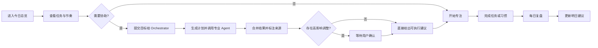

# 知行舱 PRD（产品需求文档）

版本：0.2  
负责人：Product Orchestrator  
关联契约：`shared/contracts/openapi.yaml`

## 1. 产品目标

让用户在一个工作台内完成“看清今天 → 选择行动 → 获得协助 → 专注执行 → 复盘调整”的闭环。0.2 起，协助环节由 Orchestrator 编排多个专业 Agent 完成，并把协作过程完整暴露为可观察的“运行轨迹”。

## 2. 核心流程

## 3. 功能需求

### FR-01 今日总览

- 展示日期、问候、任务完成度、Agent 动态、习惯和洞察。
- 任务完成后指标即时更新。
- 加载失败时保留本地数据并提示当前模式。

### FR-02 任务流

- 新建任务字段：名称、领域、预计时长、负责人。
- 支持编辑任务的名称、领域、预计时长与负责人，以及按领域筛选、标记完成和带入专注模式。
- 删除为软删除：归档后从任务流隐藏，可在归档箱恢复；归档任务不参与统计与 Agent 分析。
- 任务名称 1-60 字；非法输入由前后端共同阻止。
- Agent 低风险新增的任务出现在任务流中，并保留来源标记。

### FR-03 Agent 团队

- Atlas、Mira、Nova 分别承担学习、生活、成长职责，各自拥有独立配置、指令、输入输出协议、工具权限与运行状态。
- 协作中心从运行时注册表展示每个 Agent 的 Skill、能力与可用工具，不维护与后端重复的固定文案。
- 用户输入自然语言目标，Orchestrator 拆解计划并按依赖选择串行或并行调用。
- 专业 Agent 之间可 handoff，并通过共享上下文传递约束与指标。
- `rules`、`local`、`openai` Provider 都必须收到同一份运行级共享上下文；远端消息只发送必要事实，不发送历史版本。
- 返回处理状态、负责 Agent 和可执行建议，不伪装为真实异步 AI 推理。

### FR-04 专注空间

- 默认 25 分钟，支持开始、暂停、重置与切换任务。
- 倒计时在总览和专注页同步。
- 页面切换不得重置计时。

### FR-05 习惯与复盘

- 习惯可每日切换完成状态。
- 复盘包含亮点、调整项和 1-5 状态评分。
- 保存后给出明确反馈，并更新最近记录。

### FR-06 Agent 运行轨迹

- Agent 团队、目标输入和运行轨迹统一位于“协作中心”；专业 Agent 的职责、能力和工具权限必须先于目标输入展示，打开页面时自动选择最近一次运行，高级协作策略默认折叠。
- 展示 Orchestrator 如何拆解目标、调用了哪些 Agent、每个 Agent 的结果、耗时与最终汇总。
- 覆盖运行中、成功、失败、等待确认与空状态。
- 高影响建议提供“确认执行 / 暂不执行”，确认后才写入业务状态；`reschedule_block` 定位到具体任务时执行真实修改，定位不到时明确标注为建议任务。
- 风险由服务端按动作类型和工具权限判定，模型自行标注为低风险不能绕过确认；确认值必须明确为 approve / reject，同一运行的并发确认不得重复执行同一提案。
- 用户确认后的工具调用失败时，提案和运行都必须显示失败，不得以 `completed` 掩盖写入失败。
- 展示冲突识别与调和、共享上下文（含约束）与协作消息。
- 显示当前 Provider 与是否降级；不展示任何密钥。
- 模型端点在运行中调用失败时，调用与运行轨迹必须标明实际使用的 rules Provider 和具体降级原因；运行级异常必须保存为失败状态。

### FR-07 专属链接与归档

- 每个视图与单次运行都有专属 hash 链接（`#/tasks`、`#/archive`、`#/runs/:runId` 等），可直接打开、收藏、刷新保持。
- 归档箱为独立页面，列出已归档任务并提供恢复入口。
- 浏览器前进/后退可切换视图。

## 4. 非功能需求

- 首屏在现代桌面浏览器 2 秒内可交互；核心交互不依赖第三方脚本成功加载。
- 支持 360px 至 1440px 视口，键盘可完成主要操作；不出现横向溢出或遮挡。
- 无构建步骤，HTML/CSS/JS 必须每次校验（`no-cache`），避免浏览器长期持有旧版本。
- 本地服务端不可用时自动切换为 `localStorage`，不阻断用户；离线模式同样支持编辑、归档与恢复。
- 无任何模型配置时系统必须正常可用（默认 `rules` Provider）。
- API 采用 `/api/v1` 版本前缀，统一 JSON 错误结构 `{ error: { code, message } }`。
- 用户可见内容使用简体中文，代码标识符使用英文。

## 5. 数据对象

- Task：`id, title, category, duration, assignee, status, createdAt`（Agent 产生时附带 `source, agentId, origin`）
- Habit：`id, name, target, completed, streak`
- Agent：`id, name, role, status, currentTask, accent`
- Review：`id, win, adjust, mood, createdAt`
- AgentRun：`id, goal, strategy, status, provider, plan, calls, messages, memory, conflicts, applied, proposals, result, createdAt, updatedAt, finishedAt`

## 6. 验收标准

1. 首次启动可看到示例数据并成功获取 `/api/v1/state`。
2. 新建、完成任务后刷新页面，数据保持不变。
3. 切换习惯状态后服务端和 UI 一致。
4. 旧版 Agent 派发 `/api/v1/agents/:id/dispatch` 返回可展示结果，未知 Agent 返回 404。
5. `/api/v1/agents/runs` 可创建运行并查询详情，非法目标返回 400，未知运行返回 404。
6. 存在高影响建议时运行停留在 `awaiting_confirmation`，确认后状态推进并写入任务流；无待确认项时重复确认返回 409。
7. 单个 Agent 失败不影响其余 Agent，且失败信息进入轨迹。
8. 请求 `openai`/`local` 但未配置时降级到 `rules` 并标记 `degraded`，系统仍可完成运行。
9. 服务端离线时上述核心操作仍可在浏览器内完成。
10. `npm run check` 全部通过，接口错误不导致进程退出。

## 7. 后续版本

- D1/SQLite 多用户数据层与账号体系。
- Provider 真实模型接入的提示词评测与成本控制。
- 日历/课程表连接、周报导出、提醒与自动化。

## 8. 角色与操作权限

| 主体 | 可以做什么 | 必须经过的边界 |
| --- | --- | --- |
| 用户 | 新增、编辑、完成、归档、恢复任务，切换习惯，保存复盘，提交目标，批准/拒绝提案 | 表单与 API 校验；归档在界面中确认 |
| Orchestrator | 按目标选择 Agent、调度、共享上下文、检测冲突、汇总与执行授权动作 | 固定的编排与风险规则，不能由模型输出覆盖 |
| Atlas | 学习拆解、复习建议、普通任务新增、获批任务编辑 | 不允许归档、改日程或校准整体目标 |
| Mira | 负载检查、普通任务新增、获批归档/日程调整 | 不直接编辑其他任务字段，不提供诊断性建议 |
| Nova | 基于任务/复盘提炼建议、普通任务新增、获批目标校准 | 不编辑、归档任务或重排日程 |

开发期 OpenCode Agent 只用于开发审查，它们的 .opencode 权限不代表网页运行时的权限。产品 Agent 文档见 foundation/agents/*/AGENT.md，实际配置以 definitions/*.json 为准。

## 9. 页面与主流程验收细则

| 页面 | 主要输入/操作 | 应呈现的结果 | 空态与失败处理 |
| --- | --- | --- | --- |
| 今日总览 | 切换任务完成状态、进入专注、提交协作目标 | 任务完成数变化，保留来源 Agent，入口可返回其他视图 | 无任务时不阻塞协作；读取 API 失败后尝试浏览器存储 |
| 任务流 | 任务名 1-60 字、领域、预计时长、负责人，按领域筛选 | 新增、编辑与状态切换后可刷新恢复；归档任务移出主清单 | 空列可新增；未知任务或非法字段给出错误提示 |
| 协作中心 | 2-500 字目标、auto/sequential/parallel 策略 | 专业角色与权限在前，目标输入其次，历史与选中运行详情在后 | 无历史可发起；失败和降级有具体原因 |
| 专注空间 | 选择任务、开始、暂停、重置 | 页面切换保持当前倒计时；计时仅影响当前浏览器会话 | 不把展示的轮次、分钟等演示值当作真实累计统计 |
| 习惯与复盘 | 切换习惯；复盘亮点/调整项；1-5 分评分 | 保存记录与反馈，服务器模式刷新后保留 | 无评分/非法评分由 API 拒绝；缺少历史时不生成确定性趋势结论 |
| 归档箱 | 恢复已归档任务 | 恢复后回到任务流并重新参与分析 | 无归档时显示空态；未知目标返回 404 |

UI 文案、交互规则与实际统计分开验收：当前任务对象没有 dueDate，所谓“今日计划”是工作台任务切片，不是按截止日期筛出的严格日程；习惯也尚未自动跨日重置或结算 streak。两项属于后续完善，不能由文档声称已完成。

## 10. 单次协作的执行协议

1. POST /api/v1/agents/runs 提交 goal，可选 strategy、agentIds、allowHandoff。默认返回 202 和 running 快照；sync=true 等待该次完成后返回。前端通过 GET 轮询详情。
2. 未显式指定 Agent 时，根据定义中的 routing 关键词选出匹配角色；没有匹配时选择全部已启用角色。多 Agent 组合中含 Atlas 默认串行，未含 Atlas 默认并行；显式策略可覆盖。
3. 每次调用读取该运行开始时的业务快照及当前共享记忆。串行调用能读取先前 Agent 已写入的摘要和指标；并行分支不能假设读到彼此尚未完成的结果。
4. handoff 仅补充未参与过的专业 Agent，上限一轮；重复请求同一目标按目标 Agent 去重。
5. 自动应用最多 3 条普通新增任务，并受各 Agent 的自动新增额度约束；编辑、归档、日程调整、目标校准，以及显式要求确认的新增，都进入 pending。
6. 确认必须包含 proposalId 和 approve/reject；同一批 proposalId 不能重复，同一运行的确认排队执行。全部非法决定在业务写入前拒绝。
7. 合并最多 3 条用户行动建议。当前学习负载冲突由 Atlas/Mira 的固定指标检测规则实现，不是通用模型辩论或任意领域冲突引擎。

运行级共享记忆包含 goal、facts、constraints、conflicts 及来源。每个运行独立；跨运行可复用的是持久化任务/习惯/复盘，而不是自动累积的独立长期记忆库。

### 状态含义

| 状态 | 触发与用户感知 |
| --- | --- |
| running | 调用进行中，展示已有调用与耗时 |
| awaiting_confirmation | 存在待处理提案；这次运行尚未完成用户决策 |
| completed | 无待处理项且未出现提案执行失败；单个 Agent 失败可能被隔离，仍需查看 calls/result.notes |
| partially_confirmed | 待处理项已结束，其中有提案被用户拒绝；不代表系统偷偷执行拒绝项 |
| failed | 全部 Agent 失败、运行级异常，或确认项执行失败且没有剩余待确认项 |

409 表示已没有待确认事项；有其他 pending 但没有匹配的 proposalId 时返回 400。工具失败保留提案原因，不在前端假装成功。当前确认队列和持久化写队列限单进程，尚无跨文件事务或崩溃后的严格 exactly-once 保证。

## 11. 模型模式与配置验收

| 模式 | 配置 | 实际行为 |
| --- | --- | --- |
| rules | 默认；无需 Key | 各专业 Agent 执行绑定的具名 Skill 代码 |
| openai | AI_PROVIDER=openai、OPENAI_API_KEY，可选模型/完整端点 | 服务端向 Chat Completions 兼容端点发送各角色的 system 指令和 JSON 输入摘要 |
| local | AI_PROVIDER=local、LOCAL_MODEL_URL，可选模型名 | 服务端请求本机或自托管的 OpenAI 兼容完整端点 |
| browser | 已托管静态前端能打开，但 API 不可用 | 使用浏览器简化规则和 localStorage；不调用远端模型，不具备完整后端 handoff/共享记忆能力 |

启动服务与选择 Provider 是两个步骤。浏览器无法访问完全未启动的本地服务器，也就不会触发 API 离线降级。修改环境变量必须重启服务器；只把 Key 填进文件不会自动启用 openai。npm run dev 当前不自动加载 .env，README 必须给出明确可执行方式。

Windows 的 start-deepseek.cmd / npm run start:deepseek 为可选的本机专用启动器（Node.js 20.12+），显式读取项目 .env，文件配置优先于旧终端变量。只接受 openai 兼容模式与 DeepSeek 官方 HTTPS 完整端点，Key 必须在本机文件填写；漏填或配置不符时退出并提示，日志不得打印 Key，不自动发送付费请求。启动前检查不代表线上模型验收通过，也不改变通用 npm/Docker 的启动行为。

远端一次请求默认超时为 8000ms，可通过 MODEL_TIMEOUT_MS 设置 1..300000 的整数毫秒，非法值回退默认；超时必须中止请求并记录明确原因。DeepSeek 使用同一 openai 兼容适配器，设置其完整 Chat Completions 端点、模型和 DeepSeek Key，示例超时为 120000ms，不需要 OpenAI Key。Docker 必须显式透传该变量；开发期 OpenCode 配置不影响产品后端。

响应要求 JSON mode；请求失败或 JSON 解析失败时退回 rules。合法 JSON 不等于语义和字段严格合规，当前没有严格 JSON Schema 校验，也没有自动模型重试或完整 token/费用预算。

全局 GET /agents 描述的是配置可用性，不会预先验证密钥、余额、模型权限和网络。实际验收必须检查新创建的运行及 calls：requested 是请求的模式，used/provider 是实际来源，degraded 和 degradationReason 说明降级。禁止把配置徽标当作真实联调成功的证明。

## 12. 数据与接口口径

- 服务端数据位于 .runtime/state.json 与 .runtime/runs.json；浏览器离线数据位于该站点来源的 localStorage。两种存储之间没有完整的自动合并、冲突解决或离线写入回传协议。
- 任务归档保留 archivedAt/archivedBy，恢复时清除归档标记。归档任务不出现在 publicState，也不进入 Agent 的任务分析输入。
- task/goal/review 的完整接口字段与错误码以 shared/contracts/openapi.yaml 为联调基线；现有创建任务契约要求 duration、assignee，而代码对缺省值有兼容默认，严格一致性仍需后续统一。
- 远端发送目标、交接原因与 payload、最多 12 个任务、全部习惯、最多 5 条复盘、12 条共享事实、8 条约束和 5 条冲突，不发送事实历史版本。Key 不进入这些数据结构。
- User 未被建模为多账户对象，当前没有登录、数据所有者隔离、权限租户或共享工作区。

## 13. 可复现验收场景

| 场景 | 操作 | 预期 |
| --- | --- | --- |
| 无 Key 首次启动 | 按 README 启动并打开健康检查和总览 | status=ok，provider 为 rules，页面可操作 |
| 混合领域目标 | 提交“帮我安排明天的数学复习和作息节奏” | 计划包含学习/生活视角，可根据实际负载追加复盘视角，结果有来源 |
| 风险误标 | 测试 Provider 返回 low 的归档或日程动作 | 不自动执行，进入 awaiting_confirmation |
| 重复确认 | 并发批准同一条目标校准提案 | 最多一条请求执行该提案，不重复创建聚焦任务 |
| 端点故障 | 使用临时测试端点返回 503 | 该运行 used=rules、degraded=true，记录具体原因 |
| 真实模型联调 | 用户提供有效配置后主动创建新运行 | 至少一次成功调用 provider 为配置模型、degraded=false；未验证时明确记录未通过联调 |
| 重启与保留 | 保存任务/轨迹后正常停止并重启 | 两份 JSON 可恢复；不把停止服务等同于删除数据 |
| 手机长目标 | 390px 打开含长目标的运行详情 | 页面宽度不超过视口，卡片和确认按钮可用 |

## 14. 当前交付缺口

演示统计、真实跨日习惯、可靠专注事件累计、长期记忆编辑、原生模型工具调用、严格输出 Schema、令牌费用控制、跨进程事务及真实账户联调均不属于“配置 Key 即完成”的能力。按功能分别排期并补对应验收，不能仅凭页面展示或模拟端点测试判定完成。

## 15. Docker 部署验收

- Docker 是可选的单容器运行方式；安装并启动引擎后，Compose 在没有 Key/.env 的情况下以 rules 启动，健康检查通过后才视为服务就绪。
- 默认宿主机 4181、容器内部 4173，仅绑定宿主机回环地址。DOCKER_PORT 可调整，不改变 npm 本地启动的默认端口。
- 业务与轨迹 JSON 持久化到命名卷；普通停止、删除容器和重新构建保留数据，本机 npm 数据不自动导入。
- Key 通过运行时配置传入，不进入镜像和前端；更改配置重新创建容器。镜像排除本机数据和开发缓存，仍以相同工具权限、Provider 与风险规则运行。
- 文档必须覆盖 Docker Desktop 前置条件、首次启动、健康验证、日志、停止、更新、数据备份和迁移；未进行镜像构建/容器端到端测试时明确说明验证限制。
