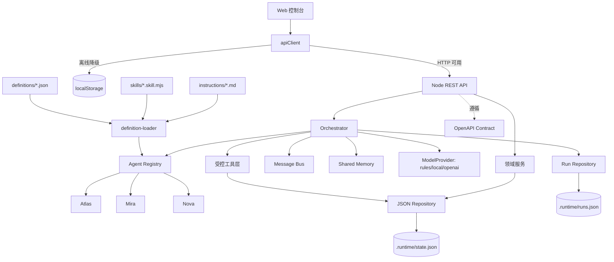

# Foundation 架构说明

## 设计原则

1. 本地优先：个人数据在没有云服务时也可完整使用。
2. 契约先行：前后端通过 OpenAPI 与稳定的领域对象协作。
3. 人在回路：Agent 输出建议，用户决定是否执行；高影响写操作必须确认。
4. 渐进增强：静态站点可独立运行，连接 API 后获得持久化和统一状态。
5. 可观察：关键决策、运行轨迹、测试结果和接口变化进入工程日志。
6. 来源诚实：默认规则引擎，绝不把规则结果描述为大模型推理；降级必须显式标注。

## 模块关系

## Agent 引擎

| 模块 | 位置 | 职责 |
| --- | --- | --- |
| Definition Loader | `server/agents/definition-loader.mjs` | 读取并校验 Agent 定义与指令文件，未知技能/工具启动即报错 |
| Skill Agent | `server/agents/skill-agent.mjs` | 由「定义 + 具名技能」装配 Agent |
| Skills | `server/agents/skills/` | 具名技能注册表：`study-coach` / `rhythm-check` / `trend-review` |
| Definitions | `server/agents/definitions/*.json` | Agent 装配配置：身份、能力、工具权限、协议、路由 |
| Instructions | `server/agents/instructions/*.md` | Agent 指令（提示词），独立于代码 |
| Registry | `server/agents/registry.mjs` | Agent 注册表、能力与运行状态 |
| Orchestrator | `server/agents/orchestrator.mjs` | 计划、调用、handoff、合并、冲突调和、确认 |
| Message Bus | `server/agents/message-bus.mjs` | Agent 间消息与运行轨迹证据 |
| Shared Memory | `server/agents/shared-memory.mjs` | 单次运行的共享事实、约束与冲突（带来源） |
| Run Repository | `server/agents/run-repository.mjs` | 运行轨迹持久化（内存 / JSON） |
| Providers | `server/agents/providers/` | 统一 `ModelProvider` 接口与 rules/local/openai 实现 |
| Tools | `server/agents/tools.mjs` | 权限校验后的业务写入：新增 / 编辑 / 归档（软删除，可恢复）；低风险自动、高影响待确认 |

## Agent 配置模型

一个 Agent 由三份来源装配，职责不重叠：

| 来源 | 决定什么 | 位置 | 谁维护 |
| --- | --- | --- | --- |
| 定义（JSON） | 身份、能力、工具权限、输入输出协议、路由关键词、启用开关 | `definitions/*.json` | 装配者 |
| 技能（代码） | 领域行为本身（返回什么建议、什么指标、什么交接） | `skills/*.skill.mjs` | 开发者 |
| 指令（Markdown） | 角色与约束的描述，接入真实模型时作为系统提示 | `instructions/*.md` | 提示词作者 |

装配在启动时完成并校验：未知技能、未知工具、缺字段、重复 id、指令文件缺失都会立即失败，不会在运行时静默降级。

**新增一个专业 Agent**：
1. 若需要新行为，在 `skills/` 增加具名技能并注册到 `skills/index.mjs`；
2. 在 `definitions/` 增加定义，引用已有或新技能，声明 `tools` 与 `routing`；
3. 在 `instructions/` 增加指令文件；
4. 无需修改 Orchestrator——路由与展示顺序自动纳入。

**刻意不可配置**：编排策略、handoff 深度上限、风险分级与确认规则、失败隔离、合并条数上限。这些属于安全与编排策略，固定在代码中。

`rules` 模式执行具名技能中的确定性代码；Markdown 指令在远端模型调用时作为系统提示。技能之间通过共享上下文与 handoff 协作。

风险分级由 Orchestrator 按动作类型和工具权限决定，只有普通新增任务可进入低风险自动执行分支。同一运行的确认请求串行处理，非法或重复的决定在执行前拒绝。两类 JSON Repository 共用各自实例的加载任务并串行提交写入，磁盘写入成功后才更新内存，写入失败不会阻塞后续重试。

## OpenCode 开发 Agent

仓库包含两套用途不同、不可混用的 Agent：

| 层 | 配置入口 | 用途 |
| --- | --- | --- |
| OpenCode 开发层 | 根目录 `opencode.jsonc`、`.opencode/agents/`、`.opencode/skills/` | 编码时由 Orchestrator 调用 Atlas / Mira / Nova 子 Agent 审查领域问题 |
| 产品运行时 | `server/agents/definitions/`、`skills/`、`instructions/` | 在知行舱网页中处理用户目标、共享上下文并通过工具层写入业务状态 |

OpenCode Agent 复用 `foundation/agents/*/AGENT.md` 的角色说明，但不会直接成为产品运行时 Agent。修改产品行为仍须遵循「定义 + 技能 + 指令」三处装配。

## Provider 策略

| AI_PROVIDER | 说明 | 不可用时 |
| --- | --- | --- |
| `rules`（默认） | 确定性规则引擎，无网络与密钥 | 不降级，本身就是最终来源 |
| `local` | 本地 OpenAI 兼容端点 `LOCAL_MODEL_URL` | 降级到 `rules` 并标记 `degraded` |
| `openai` | OpenAI 兼容接口 `OPENAI_API_KEY` | 降级到 `rules` 并标记 `degraded` |

密钥只在服务端环境变量读取，前端任何路径都不保存密钥。三个 Provider 接收相同的运行级共享上下文；远端 Provider 序列化当前事实、约束与冲突，不发送事实历史以控制输入大小。

## 运行模式

| 模式 | 命令 | 数据位置 | 用途 |
| --- | --- | --- | --- |
| 完整本地 | `npm run dev` | `.runtime/state.json`、`.runtime/runs.json` | 开发与真实前后端联调 |
| 静态预览 | 任意静态服务器托管 `dist/` | 浏览器 localStorage | 快速演示与离线使用 |
| Docker | `docker compose up -d --build --wait` | 命名卷挂载到 `/app/.runtime`，与本机 `.runtime/` 独立 | 单容器演示与部署，宿主机默认 4181 |
| 测试 | `npm test` | 临时目录 / 内存 | API、Agent 与领域行为验证 |

Docker 使用 Node 24 镜像和 node 用户，Compose 固定容器内部 HOST=0.0.0.0、PORT=4173，仅发布到宿主机 127.0.0.1 的 DOCKER_PORT（默认 4181）。镜像不包含 Key 或本机业务数据；Compose 将明确列出的环境变量传入服务器，健康检查验证 `/api/v1/health`。更新配置需重新创建容器，业务数据由命名卷保留。详细生命周期和迁移步骤见 `docs/DOCKER.md`。

## 安全边界

- API 仅接受白名单字段并限制请求体大小（32KB）。
- 运行时文件（`.runtime/`）不进入版本库。
- Agent 不直接写业务状态；写入统一经工具层并按权限与风险分级。
- 前端不保存密钥；未来模型调用必须经过服务端网关。
- 降级与失败都必须在运行轨迹中可见，不允许静默替换来源。
